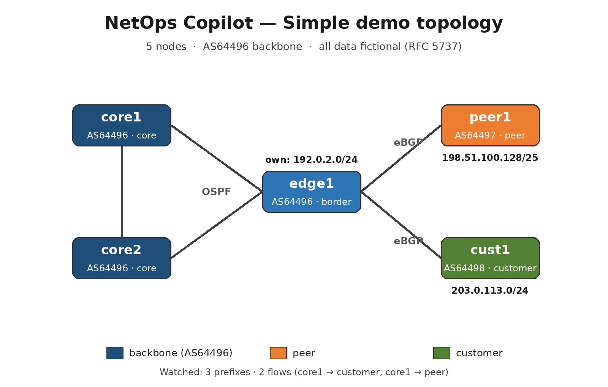
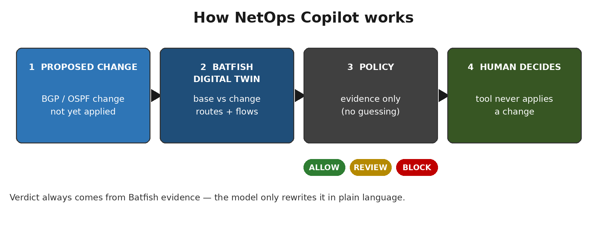

# NetOps Copilot — Meta Global AI Developer Hackathon demo

> **What is this?** A tool that simulates a BGP/OSPF change in a digital twin before it is applied to production.
> **What problem does it solve?** A bad backbone change spreads in seconds, yet checking it is still manual, slow, and easy to miss.
> **What is the verdict?** From Batfish evidence alone: 🟢 ALLOW / 🟡 REVIEW / 🔴 BLOCK. A human makes the final decision.



## Problem (2 sentences)

One bad BGP/OSPF change on an ISP backbone can spread an outage in seconds.
Yet fully checking its impact before applying it is still manual work — slow and error-prone.

## How it works (3 steps)



1. **Take the proposed change.** It is not applied to production yet.
2. **Simulate it in a Batfish digital twin.** Compare routes and flows before and after the change.
3. **Judge it by policy and explain it in plain language.** The verdict comes from evidence only; the model never overturns it.

## Scenarios

| Scenario | Change | Result |
|---|---|---|
| `ospf-cost-shift` | core1→edge1 OSPF cost 10→100 | 🟢 ALLOW — 0 watched items changed, routes and flows preserved |
| `block-peer-prefix` | edge1 blocks peer1's 198.51.100.128/25 inbound | 🔴 BLOCK — that prefix lost at 3 nodes, peer flow broken |
| `add-customer-prefix` | A new customer prefix 203.0.113.128/25 appears at edge1 (mock-only) | 🟡 REVIEW — a new route, so a human must confirm the intent |

## Policy (one paragraph)

If a watched prefix route is lost or a watched flow stops (DENIED/NO_ROUTE/DROP), the verdict is BLOCK.
If a new route appears or a flow changes non-fatally, it is REVIEW; if only next-hops change and all flows survive, it is ALLOW.

## Run

```bash
python3 copilot.py --mock --all   # no Batfish needed, ~1 second, 3 verdicts
python3 -m unittest discover -s tests   # 26 tests (simple 8 + advanced 18)
```

`--mock` uses the recorded Batfish impact reports in `demo-data/`.
So mock verdicts equal live verdicts.

Full live run (optional):

```bash
bash ~/workspace/batfish-lab/start-batfish.sh   # separate terminal, port 9996
python3 copilot.py --all   # mock-only scenarios are skipped
```

Explanation language (default is the original Korean):

```bash
python3 copilot.py --mock --all --lang en   # English explanations, same verdicts
python3 copilot.py --mock --all --lang ko   # Korean explanations (default)
```

## Model and MCP

If `META_API_KEY` is set, explanations are made by the Meta Model API (`muse-spark-1.3`) as the primary path.
When usage is returned, the report also records `usage` and `cost_usd_estimate`.

Without a key, the tool prints clearly that it is skipped and uses the local template.

Architecture rule: Batfish evidence decides the verdict (ALLOW / BLOCK / REVIEW) by fixed rules; the Meta model never decides it. The model only explains the verdict in plain language and proposes a next step (for example, keep a blackhole at /32 instead of /25), which must be re-simulated before anyone trusts it. Each report carries the proposal as "AI explanation / proposed next step (to be re-simulated — NOT the verdict)". Live API explanations are still pending a key; current reports are rule-based, and the only Meta-model-written examples are the playground samples in `demo-output/playground-samples.md`.
Never put a key value in a file (environment variable only).

There is also an MCP server (stdlib only, JSON-RPC over stdio):

```bash
python3 mcp_server.py   # tools: list_scenarios, validate_change, get_policy
```

This demo never **applies** a change. It only returns a verdict.

## Advanced version

A large lab with 13 nodes, 2 regions, and a route reflector lives in `advanced/`.
It covers 8 scenarios: link failure, BGP session down, LOCAL_PREF exit shift, hijack, RR failure, DDoS blackhole (/32 victim host), RPKI invalid origin (live via route-map enforcement), and AS_PATH prepend.
See the topology and verdict table in [advanced/README-advanced.md](advanced/README-advanced.md).

## Data notice

All topologies, prefixes, and AS numbers are fictional samples (RFC 5737 documentation ranges, AS 64496–64498).
There are no real production configs, no real customer prefixes, and no company-internal information.

## Korean version

The original simplified Korean README is kept as [README.ko.md](README.ko.md).
The advanced Korean translation is [advanced/README.ko.md](advanced/README.ko.md).
