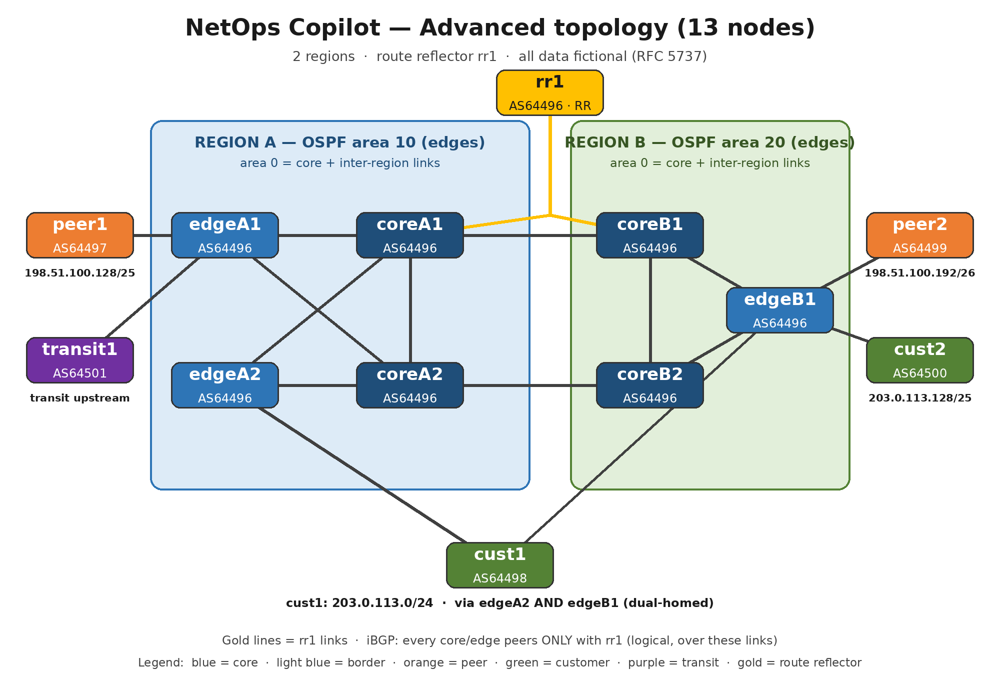

# NetOps Copilot — ADVANCED lab

> **What is this?** The same idea as the simple demo, on a realistic backbone: 13 nodes, 2 regions, a route reflector.
> **What problem does it solve?** Simple demos cannot show link failures, exit shifts, hijacks, or a reflector outage.
> **What is the verdict?** 8 scenarios: 1 ALLOW, 3 REVIEW, 4 BLOCK. Live and recorded replay agree on the 7 live scenarios; RPKI is recorded-replay-only (see below).

The basic idea (simulate first, judge from evidence, human decides) is in the [simple README](../README.md).
This file only covers what is bigger here.



## Connections (one per line)

Region A, inside:

- coreA1 — coreA2
- coreA1 — edgeA1, coreA1 — edgeA2
- coreA2 — edgeA1, coreA2 — edgeA2

Region B, inside:

- coreB1 — coreB2
- coreB1 — edgeB1, coreB2 — edgeB1

Between regions:

- coreA1 — coreB1, coreA2 — coreB2

Route reflector (gold lines in the picture):

- rr1 — coreA1, rr1 — coreB1
- iBGP: every core/edge peers ONLY with rr1 (logical sessions, not extra lines)

Outside (AS64496 border to externals):

- edgeA1 — peer1 (AS64497), edgeA1 — transit1 (AS64501)
- edgeA2 — cust1 (AS64498)
- edgeB1 — peer2 (AS64499), edgeB1 — cust2 (AS64500), edgeB1 — cust1 (AS64498, second link)

OSPF areas: area 0 for core and inter-region links, area 10 for Region A edges, area 20 for Region B edges.

## Watched prefixes and flows

| Prefix | Origin AS | Via |
|---|---|---|
| 192.0.2.0/24 (own aggregate) | 64496 | edgeA1 |
| 198.51.100.128/25 (peer1) | 64497 | edgeA1 |
| 198.51.100.192/26 (peer2) | 64499 | edgeB1 |
| 203.0.113.0/24 (cust1) | 64498 | edgeA2 and edgeB1 (dual-homed) |
| 203.0.113.128/25 (cust2) | 64500 | edgeB1 |

Watched flows (6): coreA1→cust1, coreA1→peer1, coreB1→cust2, coreB1→peer2, coreA2→peer2, coreB2→cust1.

## Scenarios

Live and recorded-replay verdicts are identical for the 7 live scenarios. RPKI has no live run (see E5).

| Scenario | Change | Verdict | What happened |
|---|---|---|---|
| `link-failure-coreA1-edgeA1` | coreA1–edgeA1 link shutdown | 🟢 ALLOW | BGP routes unchanged, all 6 flows delivered (IGP reroutes via coreA2) |
| `bgp-session-down-peer1` | edgeA1–peer1 session shutdown | 🔴 BLOCK | peer1 prefix lost at 7 nodes, peer1 flow to NO_ROUTE, customers intact |
| `localpref-exit-shift` | LOCAL_PREF 200 for cust1 at edgeB1 | 🟡 REVIEW | cust1 exit shifts edgeA2→edgeB1 at 6 nodes, all flows survive |
| `hijack-customer-prefix` | peer2 announces 203.0.113.0/25 via Null0 | 🔴 BLOCK | Flows to 203.0.113.10 go DELIVERED→NULL_ROUTED |
| `rr-failure` | rr1 interfaces shutdown | 🔴 BLOCK | 29 iBGP routes lost, all 6 flows to NO_ROUTE |
| `blackhole-rtbh-cust2` | edgeB1 /32 Null0 for victim host 203.0.113.130 only | 🟡 REVIEW | Only that host's flow goes DELIVERED→NULL_ROUTED; the cust2 /25 route stays intact, all other flows survive |
| `rpki-invalid-origin` | peer2 announces cust1 203.0.113.0/24 (ROA allows AS64498 only) — recorded replay only | 🔴 BLOCK | Invalid origin must be rejected, even though a forwarding table would show the route |
| `aspath-prepend-deprefer` | Prepend AS64496 ×2 to cust1 at edgeA2 | 🟡 REVIEW | Same exit shift as LOCAL_PREF, by a different mechanism, flows survive |

## How to run

```bash
python3 advanced/advanced.py --mock --all   # no Batfish needed, ~1 second

bash ~/workspace/batfish-lab-advanced/start-batfish-advanced.sh   # live, port 9996
python3 advanced/advanced.py --all

python3 -m unittest discover -s tests   # simple + advanced, 26 tests
```

Files here: `advanced.py` (runner), `roas.json` (fictional ROA table for the RPKI check), `demo-data-advanced/*.txt` (verbatim live impact reports, plus the recorded-replay RPKI report),
`demo-output-advanced/*.md` + `*.json` (one per scenario, labelled live or mock honestly).
The Batfish lab itself lives outside the demo repo at `~/workspace/batfish-lab-advanced/` and is not pushed to GitHub;
the demo repo carries the canned reports, so a judge can reproduce every verdict with `--mock` alone.

## Appendix — Details / honest notes

- **E1 — NULL_ROUTED is fatal.** A flow diverted to a Null0 counts as broken, like NO_ROUTE or DROP.
- **E2 — Exit shift → REVIEW.** If flows survive but a prefix's exit edge changes, a human must confirm the new exit.
  A next-hop change staying on the same edge is still ALLOW.
- **E4 — Intended blackhole (/32) → REVIEW.** If the scenario declares an intended victim host and every fatal violation is a flow to that /32 host, the drop is the intended mitigation, not an outage: REVIEW. Any non-victim break keeps BLOCK. Why /32, in plain words: a DDoS usually targets one host, so operators blackhole the /32 host route. Blackholing the whole /25 would also kill the customer's innocent hosts on the same prefix, so the /32 minimises collateral. The live proof is the granularity: the victim host flow goes DELIVERED→NULL_ROUTED while the cust2 /25 route at edgeB1 stays `bgp via ip 198.51.100.14`, unchanged, and all other 5 flows survive.
- **E5 — RPKI invalid origin → BLOCK (recorded replay only).** For a watched prefix with a ROA entry, a change route that is a direct eBGP route via a peer IP whose AS does not match the ROA AS is invalid and must be rejected — even if the forwarding table would show it, because the route itself must not be accepted. Batfish does not expose a verifiable ROV (route origin validation) state: a Cisco-style RPKI server stanza parsed OK but produced no validation state and no impact, so no live RPKI claim is made. The scenario is recorded replay (mock) — a canned report played back without a live server, explained once here and called "recorded replay" in new user-facing text — using the same documented next-hop IP → AS proxy as E3. A legitimate announcement via the ROA AS does not fire.
- **E3 — Hijack announcement → BLOCK (proxy).** A customer prefix arriving as a direct eBGP route via a peer IP is a BLOCK violation.
  Batfish's routes query returns no AS_PATH, so the direct peer next-hop is the documented proxy (peer1 .2, peer2 .10, transit .22).
  E3 is unit-tested synthetically; it did not fire in the live /25 hijack, which E1 blocks instead.
- **Hijack /24 → /25.** The exact /24 announcement was tested twice in Batfish (Loopback, then Null0 static route).
  The legitimate cust1 path was kept every time, so nothing changed. The scenario was redesigned to the classic
  more-specific /25 hijack, which actually diverts traffic. The /24 result is recorded here, not hidden.
- **Link failure shows no BGP change.** IGP reroutes via coreA2, but BGP next-hop IPs do not change.
  ALLOW is the correct verdict for the watched BGP scope, not a claim that the IGP path never changed.
- **Batfish lowercases node names** (corea1, edgeb1) in its output. The policy matches on next-hop IPs, not on name case.
- **Advanced service reuses the simple lab's Batfish runtime** (JRE + jar, not copied, own containers dir, same port 9996).
  Stop the simple service before starting the advanced one.
- **Cust1 is dual-homed** (edgeA2 + edgeB1) so LOCAL_PREF and prepend exit shifts have a second exit to move to.
  Without a second exit, neither mechanism can move the exit at all.
